.. _tutorial:

=============
Tutorial
=============
This tutorial takes the user through the atomic data needed for collisional-radiative (CR)
modeling, running ColRadPy, and analysing its results. The code blocks below are run from the
repository root, where they find the bundled adf04 files in ``examples/input``; scripts with more
examples are in the ``examples`` folder. The figures of this page are made by running its code
blocks in order with ``python docs/source/scripts/tutorial_figures.py``.

For an introduction to CR theory see the ColRadPy paper (`colradpy_paper.pdf
<files/colradpy_paper.pdf>`__, Johnson et al. 2019) and Summers et al. (2006); the
`theory manual <theory_manual.rst>`__ develops the equations that ColRadPy solves.

Many plasmas of interest, fusion edge plasmas among them, are neither in local thermodynamic
equilibrium (LTE) nor in the coronal (low-density) limit. Their level populations depend on the
electron density as well as on the temperature, and must be calculated with a CR model.
The generalized collisional-radiative (GCR) theory of Summers et al. (2006) extends the CR model to
ions with metastable levels, whose populations are followed separately.

The tutorial covers the following topics:

* `Installing ColRadPy`_
* `Atomic Data and the ADF04 File`_
* `Running ColRadPy`_
* `Post processing analysis built in functions`_
* `Post processing analysis advanced`_
* `Generalized collisional-radiative coefficients (GCRs)`_
* `Advanced functionality`_
* `Projection of the high n-shells`_
* `Atomic data from the Flexible Atomic Code`_
* `Ionization Balance`_
* `Opacity of the Lyman lines`_

Installing ColRadPy
===================
ColRadPy needs Python 3 with NumPy, SciPy and matplotlib.
From a clone of the repository, install it in editable mode (see `Installation <installation.rst>`__):

.. code-block:: bash

   pip install -e .

ColRadPy can then be imported like any other package:

.. code-block:: python
   :linenos:

   from colradpy import colradpy #import the colradpy class
   from colradpy import ionization_balance #import the ionization_balance class

Atomic Data and the ADF04 File
==============================
Atomic data are generally made by calculating the cross-sections of the processes that change the
state of an ion. Rate coefficients are then made by averaging the cross-sections over the energy
distribution of the electrons, usually a Maxwellian at the electron temperature.
These rate coefficients are what the CR model uses.

ColRadPy reads them from the ADF04 file format of `ADAS <http://www.adas.ac.uk/>`_, which holds
the levels of one ion and its atomic rate data.

Electron Impact De/Excitation
-----------------------------
Electron impact excitation and de-excitation cause transitions between the ground and the excited
levels and among the excited levels. The adf04 file stores them as effective collision strengths,
which ColRadPy converts to excitation and de-excitation rate coefficients.

Electron Impact Ionization
----------------------------
Electrons can also ionize the ion to the next charge state. The adf04 file can store ionization as
reduced ionization rates. ColRadPy can also make ionization rates with the ECIP approximation.
ECIP is a rough approximation and should be avoided where calculated rates exist. Ground and
metastable levels generally have calculated ionization rates, while the rates of excited levels are
generally supplemented with ECIP.

Radiative Recombination
-------------------------
In radiative recombination a free electron is captured by the next charge state (the parent) and
the excess energy is emitted as a photon. The adf04 file gives these rates, level resolved and
from each parent, in its recombination (R) lines, together with dielectronic recombination.

Dielectronic Recombination
----------------------------
Dielectronic recombination is the dominant recombination process in many plasmas.
It is a two-step process. First, a free electron is captured resonantly while a bound electron is
excited, so that the free electron loses its energy to the bound one. Second, the doubly excited
state stabilizes by emitting a photon instead of autoionizing.

Three-Body Recombination
--------------------------
In three-body recombination two free electrons collide with the parent ion; one is captured and the
other carries away the excess energy. ColRadPy calculates it from the ionization rates by detailed
balance.

Solutions
-----------
Once the rates are made from the atomic data, ColRadPy solves the set of rate equations known as
the collisional-radiative equations. It can solve them in two ways.

The quasistatic approximation, which most users need and which is also what ADAS uses, assumes that
the excited levels relax so fast that their populations follow the ground and any metastable levels
instantaneously. Their populations are then expressed through the populations of those retained
levels.

ColRadPy can also solve the full system of equations in time with the matrix exponential. This
solution makes no assumption about the time scales of the excited levels and is exact for fixed
plasma conditions. Once the excited levels have relaxed, it agrees with the quasistatic solution.

Running ColRadPy
===================

`ColRadPy <api/colradpy_class.rst>`__ needs the following inputs. The basic quasistatic run,
discussed first, is sufficient for most users. Once the code runs, its data are stored in the
dictionary ``.data``, whose entries are documented `here <dictionary.rst>`__.

* Atomic data input file - an ADF04 file (or the dictionary that ``colradpy.read_fac`` makes).

* Array of metastable levels - the indices of the ground and any levels that are treated as
  metastable.

* Temperature grid - an array of electron temperatures in eV.

* Density grid - an array of electron densities in cm-3.

In the example below Be I (neutral beryllium) is used, with only the ground as a metastable.
If you don't know which levels are metastable, choose only level 0 (the ground). Metastable levels
matter when their populations are not in equilibrium with the ground; in equilibrium their
fractions are fixed by the temperature and density.

The options choose the processes that are included:

* ``use_recombination=True`` uses the recombination rates of the adf04 file.

* ``use_recombination_three_body=True`` makes three-body recombination rates and includes them.
  Three-body recombination is made from the ionization rates, so it needs ionization data.

* ``use_ionization=True`` uses the ionization rates of the adf04 file.

* ``suppliment_with_ecip=True`` makes ECIP ionization rates and uses them wherever the adf04 file
  has no ionization rate.

Ionization should always be included in the calculation, even if only from ECIP: it can change both
the absolute values of the PECs and their ratios.

.. code-block:: python
   :linenos:

   from colradpy import colradpy
   import numpy as np

   fil = 'examples/input/cpb03_ls#be0.dat' #adf04 file
   temperature_arr = np.linspace(1,100,100) #eV
   metastable_levels = np.array([0])   #metastable level, just ground chosen here
   density_arr = np.geomspace(1.e10,1.e15,11) # cm-3

   #calling the colradpy class with the various inputs
   be = colradpy(fil,metastable_levels,temperature_arr,density_arr,
                 use_recombination=True,use_recombination_three_body=True,
                 use_ionization=True,suppliment_with_ecip=True)

   be.solve_cr() #solve the CR equations with the quasistatic method

``be`` is now a solved ``colradpy`` object. The results that needed the solution of the CR
equations are in the ``be.data['processed']`` sub dictionary. The methods of the class are
`documented here <api/colradpy_class.rst>`__. ``solve_cr()`` runs the steps below, which can also
be run one at a time.

.. tutorial: not run

.. code-block:: python
    :linenos:

    #what solve_cr() does
    # 1. make the rates from the adf04 file or internally (ECIP, three-body
    #    recombination)
    # 2. populate the CR matrix
    # 3. solve the matrix and make the processed data
    if(be.data['user']['use_ionization'] or
       be.data['user']['use_recombination_three_body']):
        be.make_ioniz_from_reduced_ionizrates()
    if(be.data['user']['suppliment_with_ecip']):
        be.make_ecip()
        be.suppliment_with_ecip()
    if(be.data['user']['use_recombination']):
        be.make_recombination_rates_from_file()
    if(be.data['user']['use_recombination_three_body']):
        be.make_three_body_recombination()
    if(be.data['user']['use_cx']):
        be.make_cx_rates_from_file()
    be.make_electron_excitation_rates()
    if(be.data['user'].get('projection')):
        be.make_projection()   #indirect couplings through the high n-shells

    #put all of the rates into the CR matrix
    be.populate_cr_matrix()

    #solve the CR matrix and make the 'processed' sub dictionary
    be.solve_quasi_static()

Post processing analysis built in functions
=============================================
A few built-in functions cover common analyses and need little knowledge of the data structure.
They are described first, and a more detailed analysis follows.

* The theoretical spectrum can be plotted as described in `Plotting Theoretical Spectrum (PEC sticks)`_.
* Line ratios versus temperature and density are described in `Plotting PEC ratios`_.
* The PECs and S/XB coefficients can be written to ADAS files as described in `Writing adf15 and adf13 files`_.

Plotting Theoretical Spectrum (PEC sticks)
------------------------------------------
The spectrum of photon emissivity coefficients (PECs) can be plotted with the command below.
Its arguments are lists of indices into the temperature grid, the density grid and the metastables;
one figure is made for each combination. The optional ``wave_range=(min, max)`` sets the wavelength
axis in nm, which otherwise spans the lines with PECs of at least 1e-3 of the strongest.
The plotting methods use the matplotlib style of the session and return the list of figures they
make, so a figure can be changed or saved, e.g. ``fig, = be.plot_pec_sticks([0],[0],[0])`` and
``fig.savefig('be0_sticks.png')``.

*WARNING*: the wavelengths match the NIST wavelengths only if the adf04 energy levels have been
shifted to the NIST values. This has not generally been done in the past, so many adf04 files do
not use NIST energies (see `Split LS resolved data to LSJ`_).

.. code-block:: python
   :linenos:

   be.plot_pec_sticks([0],[0],[0])

Plotting PEC ratios
---------------------
Spectral line intensities depend on the electron temperature and density as well as on the ion
density. Different lines depend differently on temperature and density, so the ratios of some lines,
in which the ion density cancels, depend mainly on temperature or mainly on density. Such ratios can
diagnose the electron temperature and density where the charge state exists in the plasma.

The temperature dependence of the ratio of two PECs is plotted below, with one figure for each
metastable requested. The arguments are the indices of the two PECs, then lists of density and
metastable indices:

.. code-block:: python
   :linenos:

   be.plot_pec_ratio_temp(0,1,[0],[0])

The density dependence is plotted in the same way, with lists of temperature and metastable indices:

.. code-block:: python
   :linenos:

   be.plot_pec_ratio_dens(0,1,[0],[0])

Writing adf15 and adf13 files
------------------------------
The PECs can be written to an adf15 file, and the S/XB coefficients (ionizations per emitted
photon) to an adf13 file, in the ADAS formats that ADAS and other codes read.
For each metastable and line, the S/XB is the effective ionization of the metastable, summed over
the parents, divided by the excitation PEC of the line from it, as ADAS208 makes it.
S/XB needs ionization in the calculation and a temperature-density grid.
Wavelengths are written in Angstroms, and the comments list each block with the upper and lower
level of its line.

.. code-block:: python
   :linenos:

   be.write_pecs_adf15('be0.adf15')
   be.write_sxb_adf13('be0.adf13')

By default every line is written to the adf15 file and every line with excitation emission to the
adf13 file; ``pec_inds`` and ``sxb_inds`` select lines by their index in ``be.data['processed']['wave_air']``.
The ADAS reader of adf13 files keeps three digits of the block index, so select at most 999 lines and
metastables for files that ADAS will read.
An adf13 file is read back with ``colradpy.read_adf13``.

S/XB is not stored with the results, as it is a ratio of them; ``get_sxb`` returns it with the shape
of the excitation columns of the PECs, (line, metastable, temperature, density), NaN where a line has
no excitation emission:

.. code-block:: python
   :linenos:

   sxb = be.get_sxb()

Post processing analysis advanced
====================================

Photon emissivity coefficients (PECs)
----------------------------------------
A theoretical spectrum can be made from the PECs. They are stored in an array of shape
(line, driver, temperature, density). The drivers are the excitation from each metastable, followed
by the recombination from each parent (and charge exchange, when it is used); for this Be I run,
driver 0 is excitation from the ground and driver 1 recombination from the Be II ground.
The wavelength and PEC arrays share the line axis. The code below plots the excitation PEC spectrum
at one temperature and density.

.. code-block:: python
   :linenos:

   import matplotlib.pyplot as plt
   met = 0 #driver 0, excitation from the ground
   te = 9  #10 eV in the temperature grid
   ne = 6  #1e13 cm-3 in the density grid

   T = be.data['user']['temp_grid'][te]
   n = be.data['user']['dens_grid'][ne]

   fig, ax = plt.subplots(figsize=(16/3, 3), layout='constrained')
   ax.vlines(be.data['processed']['wave_air'], 0,
             be.data['processed']['pecs'][:,met,te,ne])
   ax.set(xlim=(0, 1000), xlabel='Wavelength (nm)', ylabel='PEC (ph cm$^3$ s$^{-1}$)',
          title=f'PEC spectrum, $T_e$ = {T:.0f} eV, ' + '$n_e$ = 1e13 cm$^{-3}$')

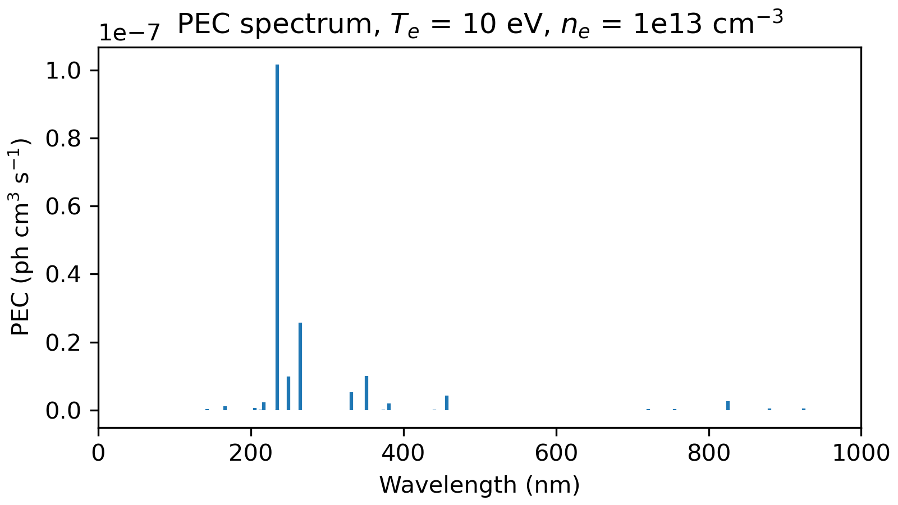

Often the index of a specific PEC is needed to find its temperature or density dependence.
It can be found in two ways:

#. from the upper and lower levels of the transition, or
#. from the wavelength of the transition.

``be.data['processed']['pec_levels']`` holds the upper and lower level of each line, in the same
order as ``be.data['processed']['wave_air']`` and ``be.data['processed']['pecs']``.
The example below takes the 2s2p 1P - 2s2 1S resonance line, from level 2 to level 0.

.. code-block:: python
   :linenos:

   print(np.shape(be.data['processed']['wave_air']),
         np.shape(be.data['processed']['pecs']),
         np.shape(be.data['processed']['pec_levels']))
   #(406,) (406, 2, 100, 11) (406, 2)

   upper_ind = 2 #2s2p 1P, the third level
   lower_ind = 0 #ground state

   pec_ind = np.where( (be.data['processed']['pec_levels'][:,0] == upper_ind) &
                       (be.data['processed']['pec_levels'][:,1] == lower_ind))[0][0]
   line = f"{be.data['processed']['wave_air'][pec_ind]:.2f} nm"

   #plot the temperature dependence of the chosen PEC at 1e13 cm-3
   fig, ax = plt.subplots(figsize=(16/3, 3), layout='constrained')
   ax.plot(be.data['user']['temp_grid'], be.data['processed']['pecs'][pec_ind,met,:,ne])
   ax.set(xlabel='Temperature (eV)', ylabel='PEC (ph cm$^3$ s$^{-1}$)',
          title=f'{line} line, ' + '$n_e$ = 1e13 cm$^{-3}$')

   #plot the density dependence of the chosen PEC at 10 eV
   fig, ax = plt.subplots(figsize=(16/3, 3), layout='constrained')
   ax.plot(be.data['user']['dens_grid'], be.data['processed']['pecs'][pec_ind,met,te,:])
   ax.set(xscale='log', xlabel='Density (cm$^{-3}$)', ylabel='PEC (ph cm$^3$ s$^{-1}$)',
          title=f'{line} line, $T_e$ = {T:.0f} eV')

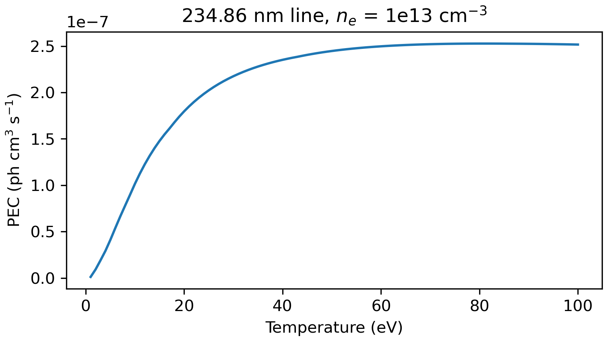

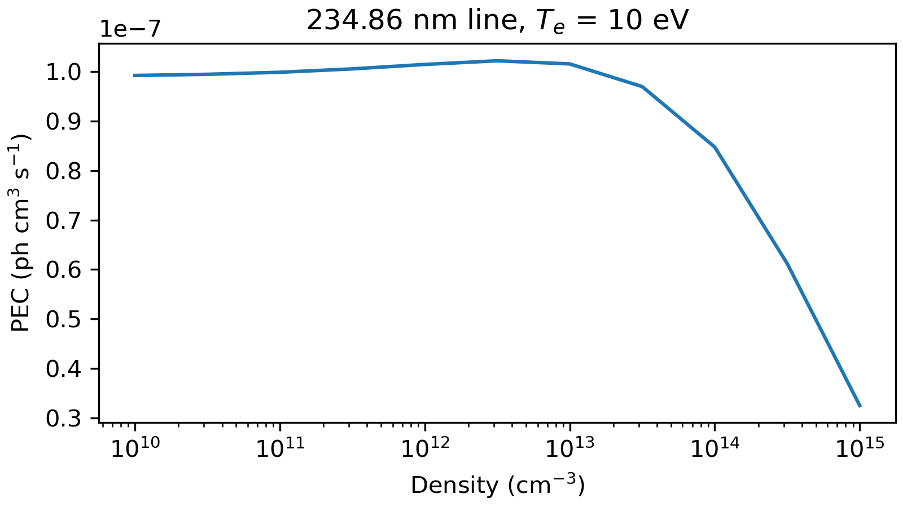

If the wavelength of a line of interest is known, its index can be found from the wavelength
array. All PECs whose wavelengths fall within the bounds of the ``where`` statement are returned.
Lines close in wavelength can usually be told apart by their PEC values, since the lines of
interest are generally much stronger.

.. code-block:: python
   :linenos:

   #find the index of the Be I line at 351.55 nm
   pec_ind = np.where( (be.data['processed']['wave_air'] < 352) &
                       (be.data['processed']['wave_air'] > 351))[0]
   print('Wavelength from file ' + str(be.data['processed']['wave_air'][pec_ind]))
   #Wavelength from file [351.55028819]
   print('PEC upper and lower levels ' +
         str(be.data['processed']['pec_levels'][pec_ind]))
   #PEC upper and lower levels [[26  2]]

Generalized collisional-radiative coefficients (GCRs)
-----------------------------------------------------
ColRadPy also calculates the generalized collisional-radiative coefficients, described in
Summers et al. (2006) and Johnson et al. (2019). They are the effective rates between the retained
populations (metastables and parents) once the excited levels are eliminated. They are inputs to
plasma transport codes and to ionization balance calculations, discussed later, which link the
charge states.

The total ionization from one charge state to the next is the SCD, and the total recombination
from the next charge state into the charge state of interest is the ACD. For ions with metastable
levels these coefficients are resolved by metastable and parent, and two further coefficients,
the QCD and the XCD, describe the transfer of population between metastables.
All four are in cm3 s-1; multiplied by the electron density they are rates in s-1.

Metastable Cross Coupling Coefficient (QCD)
---------------------------------------------
The QCD is the transfer of population from one metastable to another within the charge state of
interest, both directly and through the excited levels.

GCR Ionization Coefficient (SCD)
-----------------------------------------
The SCD is the ionization from a metastable to a parent, both directly and through the excited
levels.

GCR Recombination Coefficient (ACD)
----------------------------------------
The ACD is the recombination from a parent into a metastable of the charge state of interest,
both directly and through the cascades of the excited levels.

Metastable Parent Cross Coupling Coefficient (XCD)
-------------------------------------------------------
The XCD is the transfer of population between the metastables of the next charge state (the
parents) through the charge state of interest: a parent recombines into an excited level, the
population redistributes among the excited levels, and it ionizes to a different parent.
With the `Projection of the high n-shells`_, the XCD also includes the recombination into the high
n-shells that ionizes to another parent.

GCR Examples
---------------
This example uses Be II, because the next charge state, Be III, has two metastables
(1s2 1S and 1s2s 3S), so that the XCD is not zero. Level 1 of Be II (1s2 2p 2P) is retained here only
to show the QCD between two retained levels: it is not metastable, and its QCD to the ground is
dominated by its radiative decay divided by the density, A/ne. Remember the call from before for Be I.
The coefficients are stored as ``qcd[from, to]``, ``scd[metastable, parent]``,
``acd[metastable, parent]`` and ``xcd[from, to]`` (see the `dictionary <dictionary.rst>`__).

.. code-block:: python
   :linenos:

   from colradpy import colradpy
   import numpy as np

   fil = 'examples/input/cpb03_ls#be1.dat' #adf04 file
   temperature_arr = np.linspace(1,100,50) #eV
   metastable_levels = np.array([0,1])   #ground and level 1 chosen to be metastable
   density_arr = np.array([1.e13,8.e13,4.e14]) # cm-3
   beii = colradpy(fil,metastable_levels,temperature_arr,density_arr,
                   use_recombination=True,use_recombination_three_body=True,
                   use_ionization=True,suppliment_with_ecip=True)
   beii.solve_cr()

.. code-block:: python
   :linenos:

   #plotting the QCD
   import matplotlib.pyplot as plt
   T = beii.data['user']['temp_grid']
   fig, ax = plt.subplots(figsize=(16/3, 3), layout='constrained')
   ax.plot(T, beii.data['processed']['qcd'][0,1,:,0], label='QCD 1 -> 2')
   ax.plot(T, beii.data['processed']['qcd'][1,0,:,0], label='QCD 2 -> 1')
   ax.set(yscale='log', xlabel='Temperature (eV)', ylabel='QCD (cm$^3$ s$^{-1}$)',
          title='QCD of Be II, $n_e$ = 1e13 cm$^{-3}$')
   ax.legend()

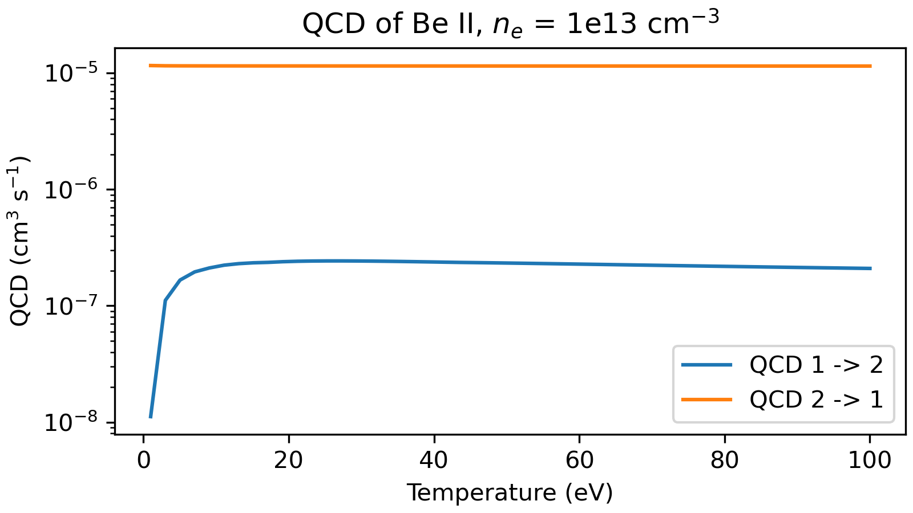

.. code-block:: python
   :linenos:

   #plotting the SCD
   fig, ax = plt.subplots(figsize=(16/3, 3), layout='constrained')
   for met in range(2):
       for parent in range(2):
           ax.plot(T, beii.data['processed']['scd'][met,parent,:,0],
                   label=f'SCD {met+1} -> {parent+1}+')
   #ionization to 1s2s 3S is negligible at the lowest temperatures
   ax.set(yscale='log', ylim=(1e-20, 1e-7), xlabel='Temperature (eV)',
          ylabel='SCD (cm$^3$ s$^{-1}$)', title='SCD of Be II, $n_e$ = 1e13 cm$^{-3}$')
   ax.legend(fontsize='small')

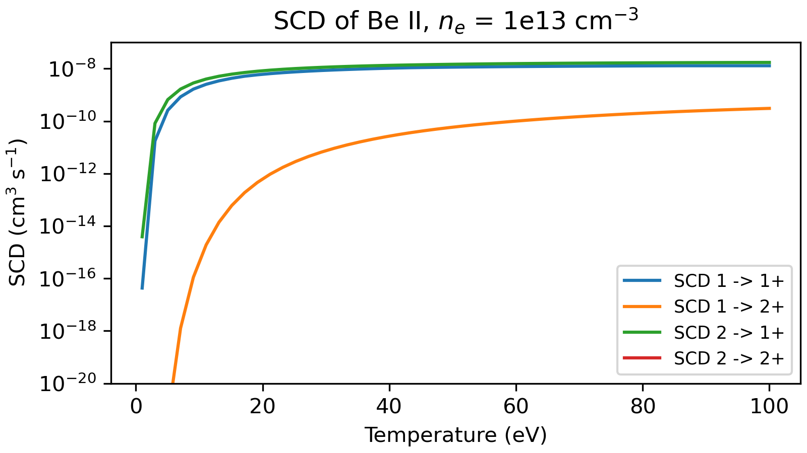

   Ionization to the 1s2s 3S parent of Be III (2+) needs about 120 eV more than ionization to the
   1s2 1S ground (1+). In this file only the Be II ground ionizes to 3S, so the SCD 2 -> 2+ is zero.

.. code-block:: python
   :linenos:

   #plotting the ACD
   fig, ax = plt.subplots(figsize=(16/3, 3), layout='constrained')
   for met in range(2):
       for parent in range(2):
           ax.plot(T, beii.data['processed']['acd'][met,parent,:,0],
                   label=f'ACD {parent+1}+ -> {met+1}')
   ax.set(yscale='log', xlabel='Temperature (eV)', ylabel='ACD (cm$^3$ s$^{-1}$)',
          title='ACD of Be II, $n_e$ = 1e13 cm$^{-3}$')
   ax.legend(fontsize='small')

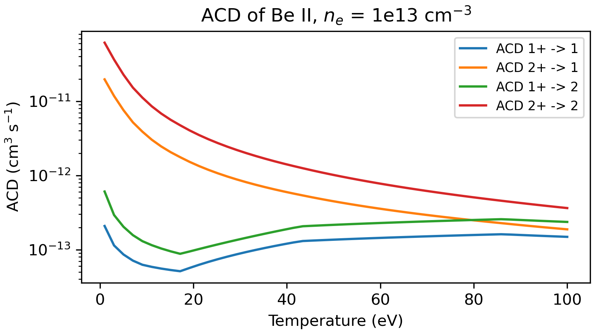

.. code-block:: python
   :linenos:

   #plotting the XCD
   fig, ax = plt.subplots(figsize=(16/3, 3), layout='constrained')
   ax.plot(T, beii.data['processed']['xcd'][0,1,:,0], label='XCD 1+ -> 2+')
   ax.plot(T, beii.data['processed']['xcd'][1,0,:,0], label='XCD 2+ -> 1+')
   ax.set(yscale='log', xlabel='Temperature (eV)', ylabel='XCD (cm$^3$ s$^{-1}$)',
          title='XCD of Be II, $n_e$ = 1e13 cm$^{-3}$')
   ax.legend()

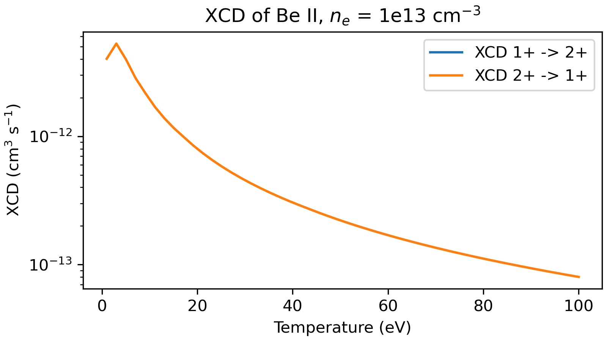

   In this file only the Be II ground ionizes to the 1s2s 3S parent, so no path through the
   excited levels leads from 1s2 1S to 3S and the XCD 1+ -> 2+ is zero (not drawn on the log
   scale). Recombination from 3S into the excited levels that then ionize to 1S gives XCD 2+ -> 1+.

Determining Populating Mechanisms
---------------------------------
ColRadPy can also determine the mechanisms that populate each level. This shows which levels and
transitions of a calculation are important for modeling the spectral lines of interest, so that
those who make the atomic data know which transitions must be accurate, and complex systems such
as near-neutral high-Z ions can be simplified.

``be.data['processed']['pop_lvl']`` keeps the terms of the quasistatic solution unsummed, with axes
(excited level, injection level, driver, temperature, density). Its entry ``[i, j, ...]`` is the part
of the population of excited level ``i`` that the driver injects into excited level ``j``; summed
over ``j`` it gives the population of level ``i``. Both level axes count the excited levels only, so
index 0 is level 1 (2s2p 3P), the first level above the ground. The first figure shows, for
level 1, the fraction of its population injected into each excited level at three temperatures; the
second shows how the fraction injected directly into level 1 by excitation from the ground changes
with temperature.

.. code-block:: python
   :linenos:

   #fraction of the population of level 1 (excited index 0) injected into each
   #excited level, from the ground (driver 0) at 1e13 cm-3
   pop_lvl = be.data['processed']['pop_lvl']
   fig, ax = plt.subplots(figsize=(16/3, 3), layout='constrained')
   for te in (0, 10, -1):
       contribution = pop_lvl[0,:,0,te,ne]
       ax.plot(np.arange(1, len(contribution)+1), contribution/np.sum(contribution),
               'o-', ms=3, label=f"$T_e$ = {be.data['user']['temp_grid'][te]:.0f} eV")
   ax.set(xlabel='Injection level (#)', ylabel='Populating fraction (-)',
          title='Populating levels of level 1')
   ax.legend()

   #fraction of the population of level 1 injected directly into it from the ground
   fig, ax = plt.subplots(figsize=(16/3, 3), layout='constrained')
   ax.plot(be.data['user']['temp_grid'],
           pop_lvl[0,0,0,:,ne]/np.sum(pop_lvl[0,:,0,:,ne], axis=0))
   ax.set(xlabel='Temperature (eV)', ylabel='Populating fraction from ground (-)',
          title='Populating fraction from the ground to level 1')

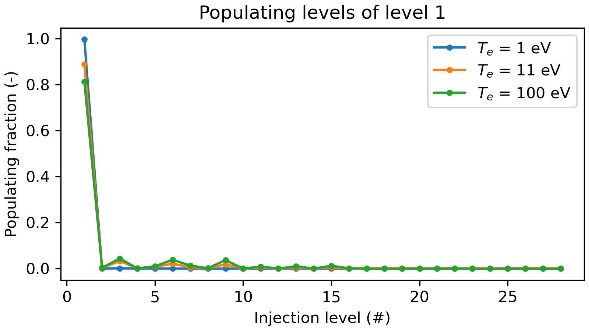

   As the temperature increases, other excited levels contribute more to the population of
   level 1.

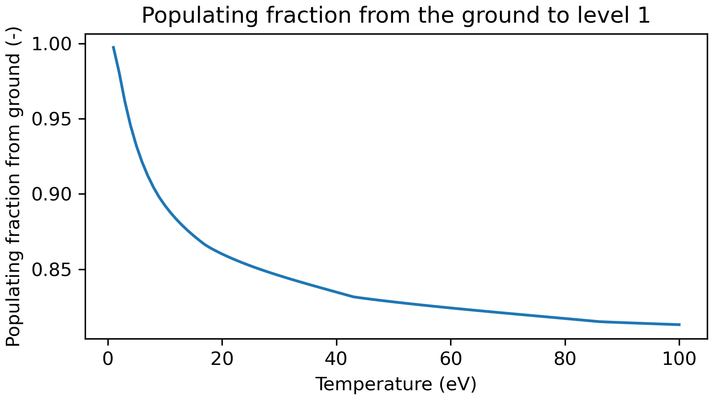

   As the temperature increases, the direct excitation from the ground contributes less to the
   population of level 1.

Advanced functionality
=======================

Time dependent CR modeling
-----------------------------
ColRadPy can also solve the full collisional-radiative matrix in time. This matters for systems
with significant population in many excited levels or where very short time scales are of interest.
Instead of the quasistatic approximation, in which the excited levels are assumed to have no
population change, the populations evolve as the system of ordinary differential equations
dN/dt = C N, with C the CR matrix. The method used to solve it was adapted from R. LeVeque.

ColRadPy considers cases with and without a source term. The case without a source can describe a
system like a linear machine viewed transverse to the motion of the particles. A source term can be
used when the line of sight includes a source of particles, or to model the pumping of specific
levels, as in laser-induced fluorescence (LIF).

The initial populations ``td_n0`` have one entry for each level of the adf04 file followed by one for
each parent: for Be I, 29 levels and the Be II ground.

.. code-block:: python
   :linenos:

   from colradpy import colradpy
   import numpy as np
   import matplotlib.pyplot as plt

   #Time dependent CR modeling
   td_t = np.geomspace(1.e-5,.1,1000)
   td_n0 = np.zeros(30)  #29 levels of Be I and the Be II ground
   td_n0[0] = 1.

   fil = 'examples/input/cpb03_ls#be0.dat' #adf04 file
   temperature_arr = np.array([10]) #eV
   metastable_levels = np.array([0])   #metastable level, just ground chosen here
   density_arr = np.array([1.e9]) # cm-3
   be = colradpy(fil,metastable_levels,temperature_arr,density_arr,
                 use_recombination=True,use_recombination_three_body=True,
                 use_ionization=True,suppliment_with_ecip=True,td_t=td_t,td_n0=td_n0)
   be.solve_cr()
   be.solve_time_dependent()

   t = be.data['user']['td_t']
   pop = be.data['processed']['td']['td_pop']
   fig, ax = plt.subplots(figsize=(16/3, 3), layout='constrained')
   ax.plot(t, pop[0,:,0,0], label='Ground')
   ax.plot(t, pop[1,:,0,0], label='level 1')
   ax.plot(t, pop[-1,:,0,0], label='ion')
   ax.set(xscale='log', xlabel='Time (s)', ylabel='Population (-)',
          title='Time dependent solution of CR Be I, no source term')
   ax.legend()

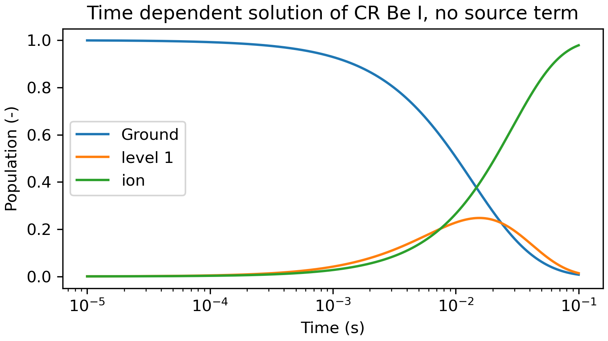

   The time history of the Be I ground, its 2s2p 3P level (level 1) and the Be II ground, from an
   initial population in the Be I ground. The 3P level is metastable and fills on a time scale
   much longer than that of the other excited levels; where such populations matter, the
   quasistatic solution should retain them as metastables. For heavy species such as Mo and W
   the quasistatic approximation can break down, and the time-dependent solution is needed.

.. code-block:: python
   :linenos:

   td_t = np.geomspace(1.e-5,1,1000)
   td_n0 = np.zeros(30)
   td_n0[0] = 1.
   td_s = np.zeros(30)
   td_s[0] = 1.  #constant source into the ground, population per second
   fil = 'examples/input/cpb03_ls#be0.dat' #adf04 file
   temperature_arr = np.array([10]) #eV
   metastable_levels = np.array([0])   #metastable level, just ground chosen here
   density_arr = np.array([1.e8]) # cm-3
   be = colradpy(fil,metastable_levels,temperature_arr,density_arr,
                 use_recombination=True,use_recombination_three_body=True,
                 use_ionization=True,suppliment_with_ecip=True,
                 td_t=td_t,td_n0=td_n0,td_source=td_s)

   be.solve_cr()
   be.solve_time_dependent()

   t = be.data['user']['td_t']
   pop = be.data['processed']['td']['td_pop']
   fig, ax = plt.subplots(figsize=(16/3, 3), layout='constrained')
   ax.plot(t, pop[0,:,0,0], label='Ground')
   ax.plot(t, pop[1,:,0,0], label='level 1')
   ax.plot(t, pop[-1,:,0,0], label='ion')
   ax.set(xscale='log', xlabel='Time (s)', ylabel='Population (-)',
          title='Time dependent solution of CR Be I, with source term')
   ax.legend()

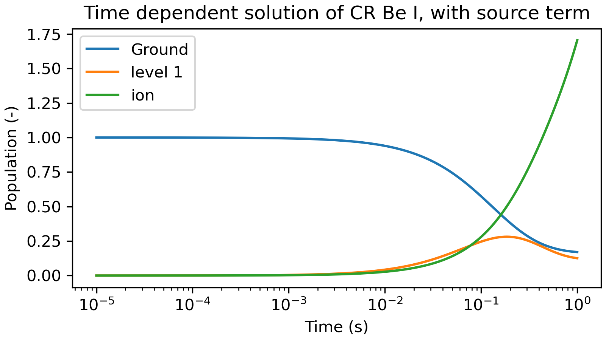

   Time dependent solution with a constant source of particles in the ground state.
   This could model spectra with a constant erosion source from the wall, or level pumping in LIF
   systems.

Split LS resolved data to LSJ
------------------------------
ColRadPy can split PECs from term resolved (LS) into level resolved (LSJ) values, with the
statistical weights of LS coupling. ``shift_j_res_energy_to_nist`` first splits the terms into their
J levels and moves the levels to the NIST energies bundled with ColRadPy, where NIST has them, so that
the split lines are at the NIST wavelengths; ``split_pec_multiplet`` then splits the PECs. Spin
changing lines and lines with ``|dL| > 1``, which these factors do not describe, are kept unsplit.
The example below splits the He I 587.6 nm multiplet (1s2p 3P - 1s3d 3D).

.. code-block:: python
   :linenos:

   from colradpy import colradpy
   import numpy as np
   import matplotlib.pyplot as plt

   he = colradpy('examples/input/Open-ADAS/adas#2/mom97_ls#he0.dat',
                 np.array([0]),np.array([20]),np.array([1.e13]),
                 use_recombination=False,use_recombination_three_body=False,
                 use_ionization=True,suppliment_with_ecip=True)
   he.solve_cr()
   he.shift_j_res_energy_to_nist()
   he.split_pec_multiplet()

   split = he.data['processed']['split']
   fig, ax = plt.subplots(figsize=(16/3, 3), layout='constrained')
   ax.vlines(he.data['processed']['wave_air'], 0, he.data['processed']['pecs'][:,0,0,0],
             label='Term resolved')
   ax.vlines(split['wave_air'], 0, split['pecs'][:,0,0,0], color='C3',
             label='Level resolved')
   ax.set(xlim=(587.5, 587.65), ylim=(0, 1e-9), xlabel='Wavelength in air (nm)',
          ylabel='PEC (ph cm$^3$ s$^{-1}$)',
          title='He I 587.6 nm, $T_e$ = 20 eV, $n_e$ = 1e13 cm$^{-3}$')
   ax.legend()

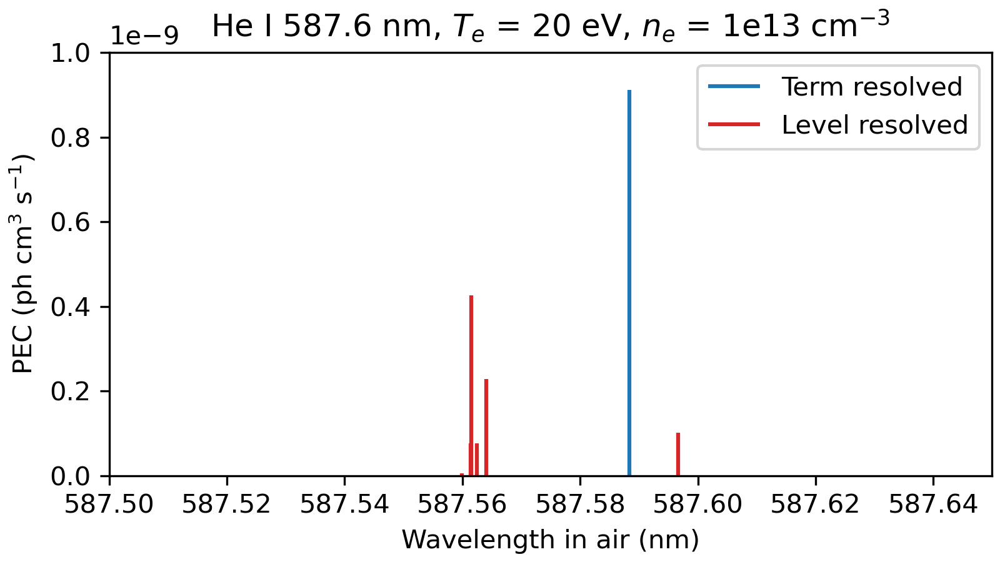

   The term resolved PEC of the 587.6 nm line at the wavelength of the adf04 terms (blue) and its
   J components at the NIST wavelengths (red), which add up to it.

Projection of the high n-shells
===============================
The levels of an ADF04 file usually cover the lowest n-shells of the ion. Recombination into
the higher n-shells, and the cascades and ionization through them, are then missing from the
collisional-radiative model, and they can be a large part of the effective recombination and
ionization. ADAS condenses the high n-shells with a bundle-nS calculation onto its lowest n-shells
for each parent and spin system (ADF17 files, e.g. ``cbnm96#f_ne1ls.dat``), and an ADF18 expansion
file of the ``a17_p208`` kind (e.g. ``exp96#f_ne1ls.dat``) maps those n-shells onto the levels of a
given ADF04 file. With both files, ColRadPy adds the indirect couplings through the high n-shells to
the CR matrix (the projection, described in the theory manual), so the populations, PECs and
GCR coefficients include them. These files are not bundled with ColRadPy; they are available from
OPEN-ADAS.

.. tutorial: not run

.. code-block:: python

   ne1 = colradpy('cop98#10_ls#ne1.dat', np.array([0, 2]), temperature_arr, density_arr,
                  projection=('cbnm96#f_ne1ls.dat', 'exp96#f_ne1ls.dat'))
   ne1.solve_cr()

The ADF18 file names the ADF04 file it maps (``DSNREF``) and its ADF17 file (``DSNCPM``); use those
files together (for H-like neon ADAS maps the n-resolved ``cop98#10_n#ne9.dat``). The indirect
couplings are in ``ne1.data['rates']['projection']``. The ADF17 temperatures are scaled with the
charge, and below the first one the projection continues the couplings with power laws and the
Boltzmann factors of their thresholds, and gives a warning.
At their lowest one to three temperatures most ADF17 files give negative indirect recombination,
which shows that the condensed data are not reliable there; the projection leaves those
temperatures out, also with a warning.
In an ionization balance, ``projection`` takes one ``(adf17, adf18)`` pair, or ``None``, for each
ADF04 file:

.. tutorial: not run

.. code-block:: python

   ion = ionization_balance(fils, np.array([0, 1]), temperature_arr, density_arr,
                            projection=[(adf17_files[i], adf18_files[i])
                                        for i in range(len(fils))])

Atomic data from the Flexible Atomic Code
=========================================
``colradpy.read_fac`` reads the atomic data of the Flexible Atomic Code (FAC,
https://github.com/flexible-atomic-code/fac) into the dictionary that ``read_adf04`` makes, which
``colradpy`` takes as its file. FAC itself is not needed to read them. The ion's files share a
prefix: ``Ar01a.en`` (levels), ``Ar01a.tr`` (radiative rates), ``Ar01a.ce`` (excitation),
``Ar01a.rr`` (radiative recombination), ``Ar01a.ai`` (autoionization and dielectronic capture) and
``Ar01a.ci`` (ionization), the ASCII tables that FAC's ``PrintTable(binary, ascii, 1)`` writes with
energies in eV. The levels are those with ``nele`` electrons; the levels of the next ion, which
FAC must also compute, are the parents. No FAC tables are bundled with ColRadPy.

.. tutorial: not run

.. code-block:: python

   import numpy as np
   from colradpy import colradpy
   from colradpy.read_fac import read_fac

   temps = np.logspace(1, 4.9, 40)          # eV
   dens = np.array([1e13, 1e14])           # cm-3
   ar16 = colradpy(read_fac('Ar02', 2, temps), np.array([0]), temps, dens)
   ar16.solve_cr()

``read_fac`` averages FAC's cross-sections over a thermal electron distribution at the temperatures
it is given, which should be those of the model (ColRadPy interpolates the rates otherwise). The
distribution is Maxwell-Juttner and the speeds are relativistic, which lowers the rates at tens of
keV (by 17% at 85 keV for the excitation of Ar\ :sup:`17+` Lyman-alpha); ``relativistic=False``
takes Maxwell-Boltzmann. Outside the energies FAC tabulates, the cross-sections follow FAC's own
asymptotic forms. ``eedf='Maxwellian_mr'`` takes instead the rate coefficients of
``pfac.fac.MaxwellRate``, from ``Ar02ce.mr``, ``Ar02rr.mr`` and ``Ar02ci.mr``, on their
temperatures. ``processes`` chooses the files (``'incl_all'`` reads all those found).

FAC's levels are jj-coupled: their J is exact (``['atomic']['w']``) and their names are in
``['atomic']['fac_name']``, but they have no LS term, so their L and S are -1. Multiplet splitting
and NIST energy shifts, which need LS terms, do not apply to them. The weights of the parents in
three-body recombination come from their J.

ADF04 data have no autoionization, so ``read_fac`` folds it into the other rates. Each flow into an
autoionizing level (dielectronic capture, excitation and radiative cascades) is multiplied by the
fraction that stabilizes radiatively, and the excitation that autoionizes is ionization of the
lower level (excitation-autoionization). The populations, satellite lines, dielectronic
recombination and ionization are then those of a model with the autoionization in its CR matrix,
as long as the collisional rates out of the autoionizing levels are small compared with their decay
rates (below about 1e20 cm-3 for highly charged ions). The capture that autoionizes to another
parent, a process of the next ion, is left out. The autoionization rates and the stabilizing
fractions are in ``['input_file']``. The two-photon decays of the H-like 2s and He-like 1s2s 1S0
levels add to their A-values, so their PEC includes the two-photon continuum
(``['rates']['two_photon']``). ``colradpy.read_fac.fac_cross_sections`` gives the cross-sections
ColRadPy integrates, for comparison with FAC's tables.

Ionization Balance
====================
An ionization balance gives the relative abundances of the charge states of an element.
It is solved with the GCR coefficients calculated from the CR equations: a matrix similar to the
CR matrix is assembled from them. SCD is the ionization from one charge state to the next, and ACD
the recombination from one charge state to the previous one. QCD transfers population between the
metastables of one charge state, and XCD between the metastables of a charge state through the
charge state below it.

ColRadPy can solve the ionization balance in time and for its steady state. The steady-state
(time-independent) abundances are the populations that no longer change, the null vector of the
ionization balance matrix. For a matrix that conserves particles, ColRadPy finds them by
Grassmann-Taksar-Heyman elimination, which keeps small abundances accurate; otherwise it takes
the eigenvector of the eigenvalue closest to zero and checks that it is a normalized, non-negative
solution of the balance equations, and if it is not, it solves the balance equations with the
normalization directly.

For ADF04 input, ``metas`` accepts either one array of level indices for the
first charge state or a list with one array per ADF04 file, which can be
followed by one for the final stage. With one array, the metastables of each
later stage are the levels that are the parents on the first line of the
preceding stage's ADF04 file, found by their terms and energies, because
ionization to parent ``p`` populates metastable ``p`` of the next stage. A
per-stage list may contain arrays of different lengths, but each must have one
level for each parent of the preceding stage; levels that differ from the
inferred parents give a warning. The selections actually used are stored as a
list in ``ion.data['user']['metas']``.

If ``init_abund`` is omitted, the first state starts with population one and
all other states start at zero. The array length is determined after the GCR
coefficients are calculated, including the final parent stage. An explicit
``init_abund`` must have one entry for every state in ``ion.data['ion_matrix']``.

The example below uses an uneven per-stage list for Be. To select only the
first stage's metastables and infer the rest, use ``metas = np.array([0, 1])``.
The time-dependent abundances are solid lines and their steady-state limits
are dotted lines.

.. code-block:: python
   :linenos:

   from pathlib import Path
   import numpy as np
   import matplotlib.pyplot as plt
   from colradpy import ionization_balance

   #the adf04 files
   input_dir = Path('examples/input')
   fils = [str(input_dir / name) for name in
           ('cpb03_ls#be0.dat', 'cpb03_ls#be1.dat', 'be2_adf04', 'be3_adf04')]
   temp = np.linspace(5,100,5) #temperature grid (eV)
   dens = np.array([1.e11,1.e14]) #density grid (cm-3)
   #metastables of each stage: they should be the parents listed at the top of the
   #adf04 file of the stage below; without them only the SCD, ACD and XCD of a stage
   #are calculated, no QCD
   metas = [np.array([0,1]),np.array([0]),np.array([0,1]),np.array([0])]

   time = np.linspace(0, .01, 1000)

   ion = ionization_balance(fils, metas, temp, dens, keep_charge_state_data=True)
   ion.populate_ion_matrix()

   ion.solve_no_source(td_t=time)

   ion.solve_time_independent()

   labels = ['be0, met0','be0, met1','be1, met0','be2, met0','be2, met1','be3, met0',
             'be4']
   fig, ax = plt.subplots(figsize=(16/3, 3), layout='constrained')
   for state, label in enumerate(labels):
       line, = ax.plot(time*1e3, ion.data['processed']['pops_td'][state,:,1,1],
                       label=label)
       ax.axhline(ion.data['processed']['pops_ss'][state,1,1], color=line.get_color(),
                  linestyle=':')
   ax.set(xlabel='Time (ms)', ylabel='Fractional abundance (-)',
          title=f'$T_e$ = {temp[1]:.2f} eV, $n_e$ = 1e14 ' + 'cm$^{-3}$')
   ax.legend(fontsize='small')

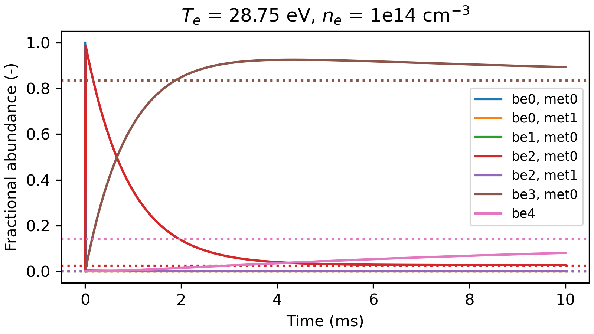

The steady-state solution as a function of electron temperature is shown below.

.. code-block:: python
   :linenos:

   temp = np.geomspace(0.3,100,200) #temperature grid (eV)
   ion = ionization_balance(fils, metas, temp, dens, keep_charge_state_data=False)
   ion.populate_ion_matrix()
   ion.solve_time_independent()

   fig, ax = plt.subplots(figsize=(16/3, 3), layout='constrained')
   for state, label in enumerate(labels):
       ax.plot(temp, ion.data['processed']['pops_ss'][state,:,1], label=label)
   ax.set(xscale='log', xlabel='Temperature (eV)', ylabel='Fractional abundance (-)',
          title='Steady state, $n_e$ = 1e14 cm$^{-3}$')
   ax.legend(fontsize='small')

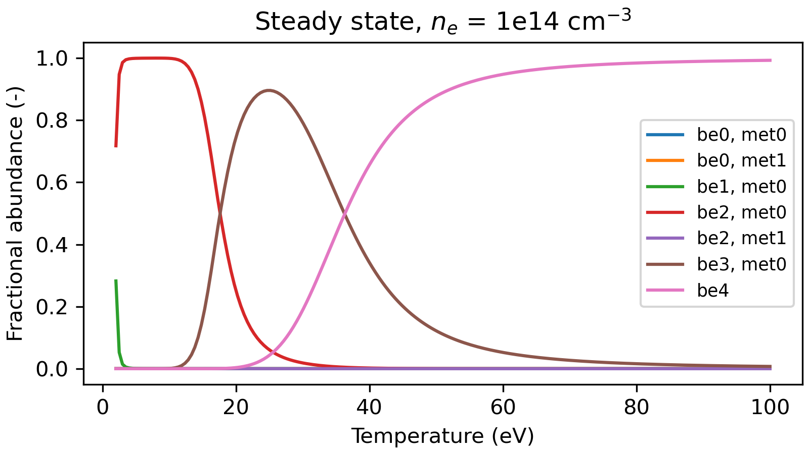

Opacity of the Lyman lines
==========================
In dense, cold plasmas, such as detached divertors, the resonance lines of hydrogen are absorbed
again by ground-state atoms before they leave the plasma. ColRadPy describes this with escape
factors (``colradpy.escape_factors`` and the theory manual). The absorption is treated as negative
emission: the populations are calculated with the A-values of the thick lines multiplied by the
population escape factor θ\ :sub:`P`. The radiance along a line of sight through the centre
of the plasma is that of the optically thin A-values times the line escape factor
θ\ :sub:`L`. Both depend on the line profile and on the optical depth at the line centre from
the centre to the edge of the plasma, τ\ :sub:`0`. The ``opacity`` argument gives the densities
of the absorbing levels (cm-3), the distance ``length`` from the centre to the edge (cm), the
``temperature`` (eV) and ``mass`` (amu) of the absorbers, and optionally the ``geometry``
(``'cylinder'``, ``'slab'`` or ``'sphere'``), the ``profile`` (``'doppler'``, or ``'voigt'`` with
the natural widths) and the ``position`` of θ\ :sub:`P` (``'average'`` over the volume, the
default, or ``'centre'``).

The example follows the one of ADAS214 (``run_adas214`` of the ADAS Python library): H I in the
conditions of the ASDEX Upgrade divertor, with 1e14 cm-3 hydrogen atoms in the ground state at
23010 K in a cylinder of radius 7.5 cm, an electron temperature of 1 eV and an electron density of
1e14 cm-3. Its n-resolved H I data are downloaded from OPEN-ADAS.

.. code-block:: python
   :linenos:

   from pathlib import Path
   from urllib.request import urlretrieve
   import numpy as np
   import matplotlib.pyplot as plt
   from scipy import constants
   from colradpy import colradpy
   from colradpy.escape_factors import population_escape_factor, line_escape_factor

   #n-resolved H I data of the ADAS214 example, from OPEN-ADAS
   h_file = 'copha#h_bn#97h.dat'
   url = 'https://open.adas.ac.uk/download/adf04/copha][h/copha][h_bn][97h.dat'
   if not Path(h_file).exists():
       urlretrieve(url, h_file)

   temp = np.array([1.])   #electron temperature (eV)
   dens = np.array([1e14]) #electron density (cm-3)
   #absorbers: 1e14 cm-3 H atoms in the ground state at 23010 K,
   #in a cylinder of radius 7.5 cm
   opacity = {'length': 7.5, 'densities': {0: 1e14}, 'mass': 1.008,
              'temperature': 23010*constants.k/constants.e, 'geometry': 'cylinder'}

   h_thin = colradpy(h_file, np.array([0]), temp, dens)
   h_thin.solve_cr()
   h_thick = colradpy(h_file, np.array([0]), temp, dens, opacity=opacity)
   h_thick.solve_cr()

   escape = h_thick.data['rates']['escape']
   #the (upper, lower) levels of the lines
   lines = {'Ly-alpha': (1, 0), 'Ly-beta': (2, 0), 'H-alpha': (2, 1)}
   for name, levels in lines.items():
       tau0 = escape['tau0'][levels]
       centre = population_escape_factor(tau0, 'cylinder', position='centre')
       print(f"{name:8s} tau0 {tau0:6.2f}, theta_p {escape['theta_p'][levels]:.4f}"
             f" (centre {centre:.4f}), theta_l {escape['theta_l'][levels]:.4f}")
   #Ly-alpha tau0  29.19, theta_p 0.0407 (centre 0.0077), theta_l 0.0413
   #Ly-beta  tau0   4.67, theta_p 0.1914 (centre 0.0724), theta_l 0.1974
   #H-alpha  tau0   0.00, theta_p 1.0000 (centre 1.0000), theta_l 1.0000

   #populations of n = 2-5 with opacity relative to the optically thin ones
   print(np.round(h_thick.data['processed']['pops'][:, 0, 0, 0]/
                  h_thin.data['processed']['pops'][:, 0, 0, 0], 2))
   #[19.18  5.57  5.39  5.48]

Only the lines that end on a level of ``densities`` are thick, here the Lyman lines; H-alpha
stays thin. Ly-alpha keeps 4% of its photons, so its upper level n = 2 is 19 times more populated
than without opacity. Ly-beta is less thick. Its absorbed photons excite n = 3 again, which then
also decays through H-alpha, and the populations from n = 3 up are 5.5 times higher.
``position='centre'`` gives the escape factor at the centre of the plasma, as ADAS214 does. It is
several times smaller than the average over the volume, because a photon emitted at the centre
has to cross the whole radius, while those emitted near the edge leave easily. The ADAS214
example also has a parabolic emission profile, a Voigt profile whose Lorentzian width is 0.14
times the Doppler width, and a cylinder of finite length (aspect ratio 5), which ColRadPy does not
model, so its escape factors differ from these.

The optical depth is proportional to the density of the absorbers, so the escape factors at other
densities follow from τ\ :sub:`0` with the functions of ``colradpy.escape_factors``. The grey
line marks the density of the example.

.. code-block:: python
   :linenos:

   n_ground = np.geomspace(1e10, 1e16, 61) #H ground-state density (cm-3)
   fig, ax = plt.subplots(figsize=(16/3, 3), layout='constrained')
   for name, color in (('Ly-alpha', 'C0'), ('Ly-beta', 'C1')):
       tau0 = escape['tau0'][lines[name]]*n_ground/opacity['densities'][0]
       ax.plot(n_ground, population_escape_factor(tau0, 'cylinder'), color=color,
               label=name + r' $\theta_P$')
       ax.plot(n_ground, population_escape_factor(tau0, 'cylinder', position='centre'),
               color=color, linestyle='--', label=name + r' $\theta_P$ centre')
       ax.plot(n_ground, line_escape_factor(tau0), color=color, linestyle=':',
               label=name + r' $\theta_L$')
   ax.axvline(opacity['densities'][0], color='0.6', linewidth=0.8)
   ax.set(xscale='log', yscale='log', ylim=(1e-4, 2),
          xlabel='H ground-state density (cm$^{-3}$)', ylabel='Escape factor (-)',
          title='Cylinder, $R$ = 7.5 cm, $T$ = 23010 K')
   ax.legend(fontsize='x-small', ncols=2)

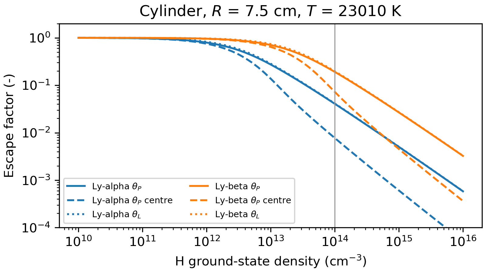

The PECs change with the populations, so the model is solved again for each density of the
absorbers. ``processed['pecs']`` are the net PECs, with the A-values times θ\ :sub:`P`, and
``processed['pecs_los']`` those of the radiance along the line of sight through the centre, with
the thin A-values times θ\ :sub:`L`, which a spectrometer looking through the centre of the
plasma measures. The two are the same for thin lines. The figure shows the excitation PECs along
the line of sight relative to the thin ones.

.. code-block:: python
   :linenos:

   pec_levels = h_thin.data['processed']['pec_levels'].tolist()
   pec_ind = {name: pec_levels.index(list(levels)) for name, levels in lines.items()}
   n_scan = np.geomspace(1e10, 1e16, 25)
   ratio = {name: [] for name in lines}
   for n_h in n_scan:
       h_scan = colradpy(h_file, np.array([0]), temp, dens,
                         opacity={**opacity, 'densities': {0: n_h}})
       h_scan.solve_cr()
       for name, ind in pec_ind.items():
           ratio[name].append(h_scan.data['processed']['pecs_los'][ind, 0, 0, 0]/
                              h_thin.data['processed']['pecs'][ind, 0, 0, 0])

   fig, ax = plt.subplots(figsize=(16/3, 3), layout='constrained')
   for name in lines:
       ax.plot(n_scan, ratio[name], label=name)
   ax.axhline(1, color='0.6', linewidth=0.8)
   ax.set(xscale='log', yscale='log', xlabel='H ground-state density (cm$^{-3}$)',
          ylabel='PEC / thin PEC (-)',
          title='$T_e$ = 1 eV, $n_e$ = 1e14 cm$^{-3}$, excitation')
   ax.legend(fontsize='small')

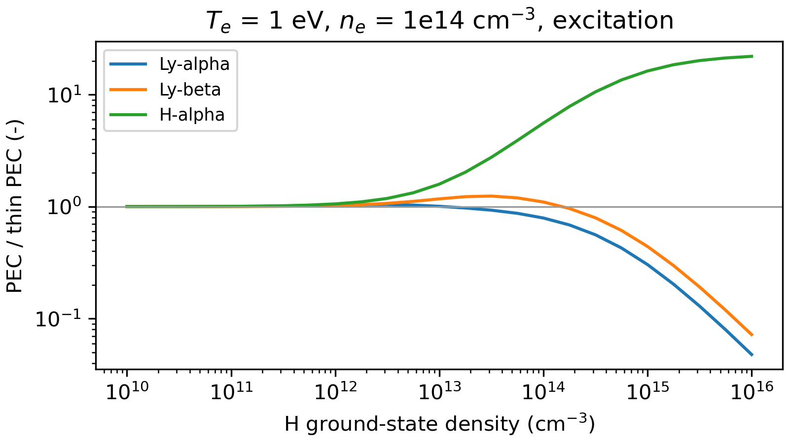

While the trapping is weak, an absorbed photon is emitted again until it leaves the plasma, and
the lines keep their strength. Ly-beta first rises by up to 20%, as n = 3 is also excited from the
more populated n = 2. Each time a Ly-beta photon is absorbed, n = 3 can decay through H-alpha
instead, so with stronger trapping Ly-beta falls and H-alpha rises: 5.6 times at the density of
the example and 22 times at 1e16 cm-3. Ly-alpha falls when the collisions of n = 2 compete with
its reduced decay. The densities of the absorbers are inputs: ColRadPy does not adjust them to
the populations it calculates.
